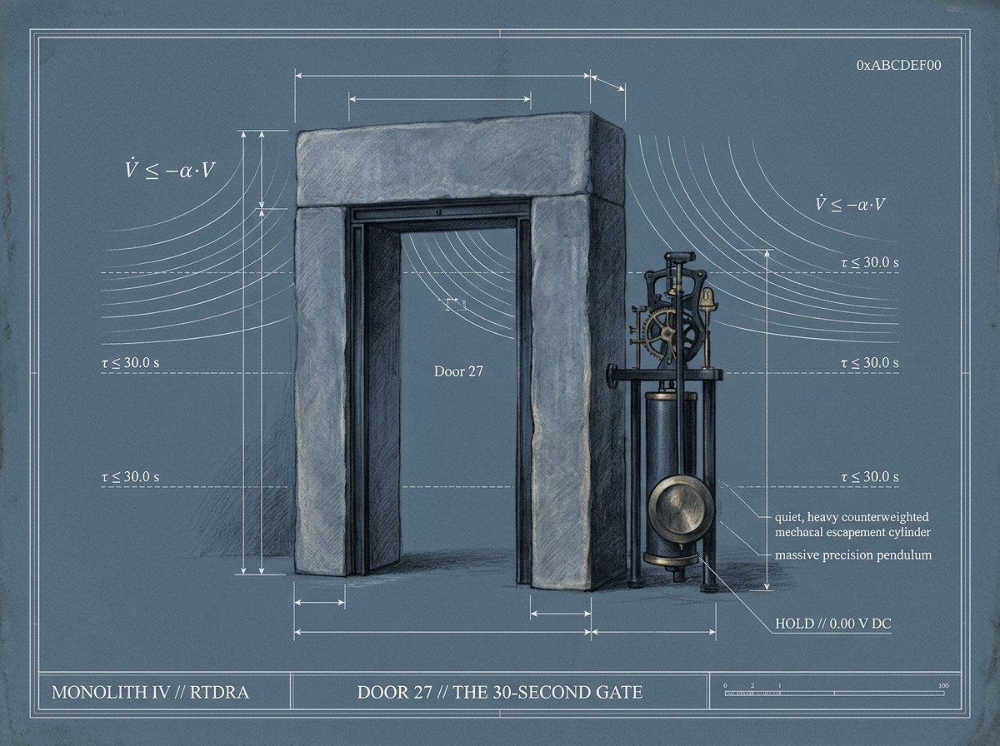
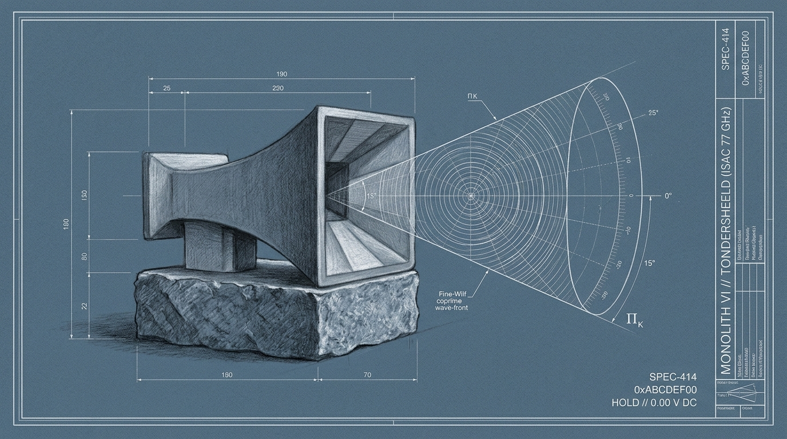
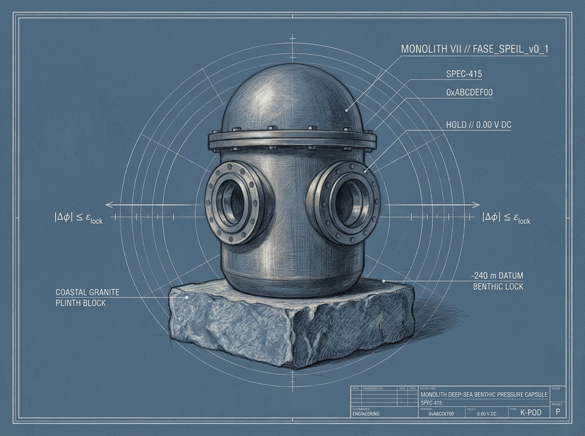
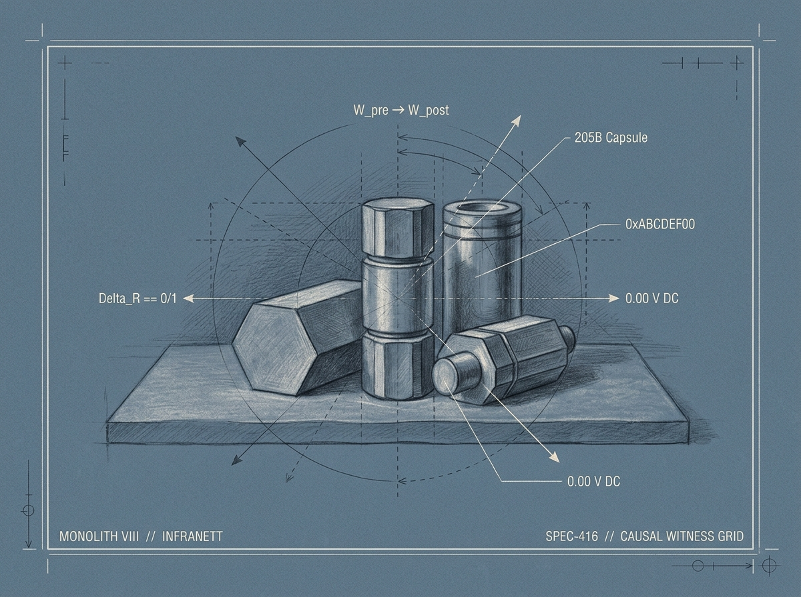
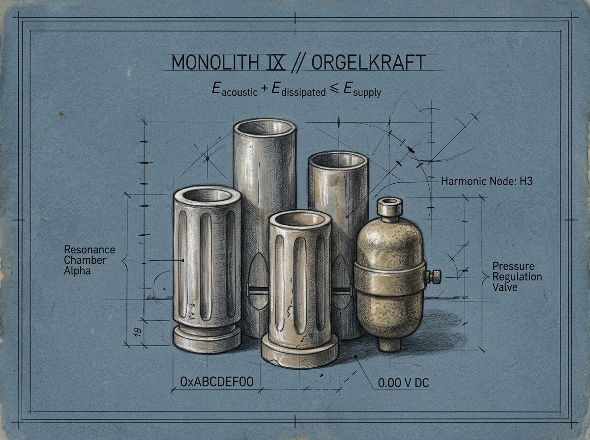
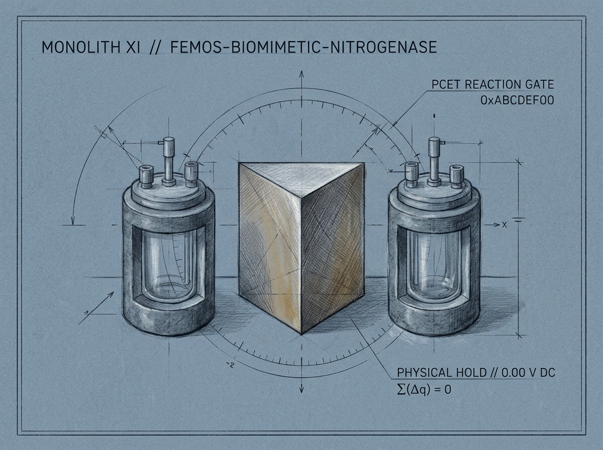

# Monolitt — Project Map & SHA-256 Provenance Seals

[](https://doi.org/10.5281/zenodo.24032518)
[](https://orcid.org/0009-0006-0431-6637)
[-0A66C2?style=flat-square)](https://www.linkedin.com/groups/40622443/)

> **Coordinate (`5 · Seal`):** [`(0,0) sololys`](https://github.com/sololys) — [`1 · Word`](https://github.com/sololys/skrivevaerelset) → [`2 · Draft`](https://github.com/sololys/epistemic-architectures-notes) → [`3 · Rule`](https://github.com/sololys/epistemic-architectures) → [`4 · Gate`](https://github.com/sololys/ky-rox-public-demonstrators) → **`[5 · Seal]`**

**Monolitt** (*The Monolith*) is the public project map and SHA-256 provenance boundary for the **11 private prototype repositories** in the `sololys` constellation.

Where the first four public rooms hold essays ([`skrivevaerelset`](https://github.com/sololys/skrivevaerelset)), working derivations ([`epistemic-architectures-notes`](https://github.com/sololys/epistemic-architectures-notes)), formal rules ([`epistemic-architectures`](https://github.com/sololys/epistemic-architectures)), and runnable gate demonstrators ([`ky-rox-public-demonstrators`](https://github.com/sololys/ky-rox-public-demonstrators)), **Monolitt** publishes verifiable SHA-256 descriptor seals without exposing private source trees.

---

## 0. Portal IV — De 2,7 Ångstrømmene, Rue Lhomond 1898 og messingsplinten på 1 200 newton ($\gamma_{00,\text{IV}}^*$)

Det begynner ikke med svaret, men med kulden i rommet der beregningen tar slutt. En prosessor kan spinne ut millioner av gyldige syntaktiske baner på et blunk uten at et eneste gram materie har flyttet seg, for i minnet veier tallet fire tusen og nittiseks nøyaktig like lite som tallet én. Det vi har vennet oss til å kalle digital skaperkraft, er i bunn og grunn et løfte som aldri har måttet møte motvekt. Sannheten om et byggverk viser seg ikke mens tegningen ligger glatt på skjermen, men i det øyeblikket stillaset rives og bjelken enten bærer taket eller knekker under sin egen tyngde.

Mellom det som lar seg tenke uten kostnad, og det som faktisk består i verden, står en nådeløs port. Virkeligheten utstedes ikke på bestilling; den innvilges kun til det som overlever møtet med fysiske og geometriske skranker. I kaliumkanalen i et nyfødt hjerte — som i krone-eterens seks oksygenatomer på verkstedbenken — måler denne porten eksakt 2,7 Ångstrøm. Et natriumion er mindre enn kaliumionet og burde i en tankeløs verden smette lettere gjennom åpningen, men fordi det er for lite til å berøre veggene og gjøre opp energiprisen for vannkappen det må kle av seg, avvises det ti tusen ganger av ti tusen. Naturen gjetter aldri når grunnlaget svikter, og den bygger ikke orden ved å stable nye lag med kode oppå skjøre antakelser. Presisjon oppstår ved å skjære bort ulovlige frihetsgrader inntil bare én ufravikelig bane står igjen.

Før denne terskelen krysses, kan tanken snus, speiles og prøves uten at verden utenfor tar skade. I det øyeblikket spenningen slippes frem til jernet og en handling rører ved terrenget, stenges imidlertid returveien for alltid. Hver gnist over en kobberkontakt som slår inn, hver varmegrad som siver ut i novemberregnet ved 2,6523 zeptojoule per slettet bit, og hvert alfakorn som brant seg inn i papiret i Marie Curies laboratoriebøker i Rue Lhomond i 1898, etterlater et spor som ingen angreknapp kan hente tilbake. Derfor oppbevares hennes gulnede notater fremdeles bak bly i Paris, pustende av radon mer enn hundre og tjue år etter at pennen slapp arket. Å påstå at en utført handling i materien, i biologisk vev eller i et menneskes rettslige liv kan rulles tilbake som en feilskrift i en database, er ikke bare en regnefeil; det er en forfalskning av grensen mellom kart og terreng.

Fordi konsekvensen er ugjenkallelig, er det modne verktøyet bygget for å kunne si nei. Når signalet utenfra kommer ett nanosekund for sent over tyve meter — etter 133,4256 nanosekunder — vet krystallklokken at budskapet har tatt en ulovlig omvei utenfor lyskjeglen, og slipper pakken lydløst i gulvet for åtte mikrojoule uten å vekke vaktmannskapet. Når et menneske i krise eller avklaring står midt i usikkerheten, skal ikke systemet kaste vedkommende utfor et brått stup eller tvinge frem et panikklikk med hylende alarmer; det skal åpne en skjermet hvilelomme i ravfarget taushet og holde beslutningsporten lukket i tretti hele sekunder til blodet har trukket seg tilbake fra tinningen og tanken igjen bærer seg selv. Tiden alene har ingen stemmerett; taushet og ventetid kan aldri gli over i taus godkjenning.

Og når selve kjernen svikter — når massebalansen på 141,100998 kilogram sprekker med mer enn vekten av et sandkorn, eller når et byråkrati forsøker å gjøre borgerens eget avslag til bevis på manglende samtykkekompetanse — bytter tiden og vitnet plass over de fire hundre klokkeslagene mellom prosessor og disk. Å åpne for ny makt krever at vitnesbyrdet brennes inn i fast minne i fem millisekunder før én eneste volt slippes løs. Å stanse et overtramp skjer momentant på første klokkeslag: spenningen kuttes til jord på nanosekunder, skjermen stivner i tørr oker, og herdede stålfjærer trekker kobberklossene fem millimeter fra hverandre i kald luft mens obduksjonsrapporten skrives ferdig i bakgrunnen.

Foran disse fem millimeterne med luft ved 0,00 volt stanser dette skriftet, og her opphører all maskinell myndighet. Intet lukket system kan utstede sitt eget vitne innenfra, og alle verdens serverparker eier null watt muskelkraft over et åpent mekanisk gap. Selv når et menneske av kjøtt og blod ved syttiogtre tidels varmegrader over grunnfjellet går ut over frossen grus og legger sin egen rygg mot bakelitthåndtaket, har heller ikke viljen lov til å lyve for virkeligheten: ligger feilen ennå uløst i mørket der inne, ryker messingsplinten ved tusen og to hundre newton slik at grepet går rundt i løse luften. Først når regnskapet i dypet faktisk er gjort opp med null i rest, tar det herdede stålet imot vekten. Planken ligger hugget og tørr over kløften, med fem ubeskrevne byte klaring mot muren — men vekten som prøver om den holder, og signaturen som hefter når strømmen går på, kan aldri tilhøre andre enn deg som står utenfor siden.

---

## 1. Zero-Knowledge Disclosure Protocol (Black-Box Contract)

Every monolith indexed in this repository adheres to a strict **epistemic boundary**:

$$\Phi(\text{State}) \longrightarrow \Pi_K(\text{Admissibility}) \longrightarrow \Omega \in \{\text{OPEN}, \text{HOLD}, \text{KILL}\}$$

| Layer | Publicly Indexed in `monolitt` (Green Light) | Sealed in Private Ring II Vaults (Red Light — `0.00 V`) |
| :--- | :--- | :--- |
| **1. Monolith Identity** | Canonical Monolith ID (`MONOLITH I`–`XI`) & Domain Class | Internal module trees, proprietary file paths, customer topologies |
| **2. Epistemic Law** | Governing conservation law or barrier invariant ($\Phi \to \Pi_K \to \Omega$) | Calibrated process constants, reactor geometry, catalyst stoichiometry, Riccati weights |
| **3. Gate Signature** | Abstract state-vector domain $\to$ consequence output $\{\text{OPEN}, \text{HOLD}, \text{KILL}\}$ | Proprietary parsers, hardware drivers, routing kernels, commercial IP |
| **4. Witness Seal** | 7-char `HEAD` commit witness & 16-char SHA-256 descriptor seal | Commercial roadmaps, financial syntheses, deployment credentials |

> **Epistemic Boundary (`AGENTS.md` Invariant):**  
> `INSPIRED_BY != IMPLEMENTS != PROVES`. All cryptographic seals and verification scripts in this repository operate at **Evidence Tier `L1`** (locally demonstrated deterministic software). Software hash chains are append-only cryptographic ledgers, not physical WORM hardware media.

---

## 2. Ring II Sovereign Monolith Index (`11/11 Sealed`)

| Monolith | Chamber Codename | Primary Domain | Vault Witness | Descriptor Seal (`SHA-256[:16]`) |
| :--- | :--- | :--- | :--- | :--- |
| **I** | `GEMINI-CORE` | Locus Zero Monorepo & Consequence-Gated Research Kernel | `3a603d4` | `37e47671b4048337` |
| **II** | `BRAHMAN.1` | $\mathrm{GF}(2^8)$ Algebraic Syndrome & Hardware Consequence Core | `5f24d9d` | `0d985a28e34953c2` |
| **III** | `KREATIVSYSTEMS.1` | Industrial Orchestration & Deterministic Release Synthesis | `e61b1e3` | `09a3925b6e53807d` |
| **IV** | `RTDRA` | Real-Time Deterministic Routing & Cyber-Physical Fleet Authority | `c26970a` | `5ede196de878551f` |
| **V** | `AIC-COACHING-SOVEREIGN-ENGINE` | Sovereign Decision-Support & Epistemic Drift Auditing | `cc6912f` | `636d61cd27b04338` |
| **VI** | `TONDERSHEELD` | Perimeter Isolation & Fail-Closed Defensive Boundary | `26f0feb` | `ba20559faf258a5e` |
| **VII** | `FASE_SPEIL_v0_1` | Phase-Coherent State Reflection & Bidirectional Telemetry | `cc49399` | `b9e157084badda8c` |
| **VIII** | `INFRANETT` | Air-Gapped Mesh Transport & Append-Only Hash-Chain Storage | `c9be2fd` | `946389699e32e78c` |
| **IX** | `ORGELKRAFT` | Harmonic-Acoustic & Electro-Mechanical Actuation Synthesis | `27b80aa` | `53518b84579d1333` |
| **X** | `GSCX-BATTERY-ENERGY-NETWORK` | Grid-Scale Electrochemical Storage & Thermal Envelope Gate | `e9b6f11` | `85394342bccaa04b` |
| **XI** | `FEMOS-BIOMIMETIC-NITROGENASE` | Biomimetic FeMo-Cofactor Catalytic Simulation & Reaction Gate | `c4296e6` | `bbc8d053f9fac3dd` |

* **Monolith Master Merkle Root (`SHA-256`):** `f11b280003e49fd141bd1a51aedd6c66bb6fbb3d62e03a21fe1753fc925fc3b1`

---

## 3. The 11 Sealed Monoliths (`MONOLITH I – XI`)

### MONOLITH I // `GEMINI-CORE`

```text
┌────────────────────────────────────────────────────────────────────────────┐
│ MONOLITH I // GEMINI-CORE                                  [RING II VAULT] │
├────────────────────────────────────────────────────────────────────────────┤
│ Domain      : Locus Zero Monorepo & Consequence-Gated Research Kernel      │
│ Invariant   : Phi(State) -> Pi_K(Admissibility) -> Omega(Consequence)      │
│ Gate I/O    : StateVector[N] x WitnessID -> {OPEN, HOLD, KILL}             │
│ Evidence    : L1_DETERMINISTIC_SOFTWARE (INSPIRED_BY != IMPLEMENTS)        │
│ Witness Seal: HEAD @ 3a603d4  |  SHA-256[:16]: 37e47671b4048337            │
│ Vault State : PRIVATE_RING_II // 0.00 V DC (ALL RIGHTS RESERVED)           │
└────────────────────────────────────────────────────────────────────────────┘
```

### MONOLITH II // `BRAHMAN.1`

```text
┌────────────────────────────────────────────────────────────────────────────┐
│ MONOLITH II // BRAHMAN.1                                   [RING II VAULT] │
├────────────────────────────────────────────────────────────────────────────┤
│ Domain      : GF(2^8) Algebraic Syndrome & Hardware Consequence Core       │
│ Invariant   : S(r) = H * r^T in GF(2^8) [p(x) = 0x11D]; S != 0 => HOLD     │
│ Gate I/O    : Frame[208B] x CRC32 -> {OPEN (24V), HOLD (0V), KILL (0V)}    │
│ Evidence    : L1_DETERMINISTIC_SOFTWARE (RTL Simulation & Gate Vectors)    │
│ Witness Seal: HEAD @ 5f24d9d  |  SHA-256[:16]: 0d985a28e34953c2            │
│ Vault State : PRIVATE_RING_II // 0.00 V DC (ALL RIGHTS RESERVED)           │
└────────────────────────────────────────────────────────────────────────────┘
```

### MONOLITH III // `KREATIVSYSTEMS.1`

```text
┌────────────────────────────────────────────────────────────────────────────┐
│ MONOLITH III // KREATIVSYSTEMS.1                           [RING II VAULT] │
├────────────────────────────────────────────────────────────────────────────┤
│ Domain      : Industrial Orchestration & Deterministic Release Synthesis   │
│ Invariant   : Idempotent Build Graph: H(Source_Tree) == H(Manifest_Target) │
│ Gate I/O    : BuildDAG x SHA256_Manifest -> {OPEN, HOLD, KILL}             │
│ Evidence    : L1_DETERMINISTIC_SOFTWARE (Reproducible Artifact Pipeline)   │
│ Witness Seal: HEAD @ e61b1e3  |  SHA-256[:16]: 09a3925b6e53807d            │
│ Vault State : PRIVATE_RING_II // 0.00 V DC (ALL RIGHTS RESERVED)           │
└────────────────────────────────────────────────────────────────────────────┘
```

### MONOLITH IV // `RTDRA`



```text
┌────────────────────────────────────────────────────────────────────────────┐
│ MONOLITH IV // RTDRA                                       [RING II VAULT] │
├────────────────────────────────────────────────────────────────────────────┤
│ Domain      : Real-Time Deterministic Routing & Cyber-Physical Authority   │
│ Invariant   : Lyapunov Barrier V_dot <= -alpha*V & Latency <= tau_crit     │
│ Gate I/O    : TelemetryFrame x SafetyEnvelope -> {OPEN, HOLD, KILL}        │
│ Evidence    : L1_DETERMINISTIC_SOFTWARE (Zero-Jitter Consequence Routing)  │
│ Witness Seal: HEAD @ c26970a  |  SHA-256[:16]: 5ede196de878551f            │
│ Vault State : PRIVATE_RING_II // 0.00 V DC (ALL RIGHTS RESERVED)           │
└────────────────────────────────────────────────────────────────────────────┘
```

### MONOLITH V // `AIC-COACHING-SOVEREIGN-ENGINE`

```text
┌────────────────────────────────────────────────────────────────────────────┐
│ MONOLITH V // AIC-COACHING-SOVEREIGN-ENGINE                [RING II VAULT] │
├────────────────────────────────────────────────────────────────────────────┤
│ Domain      : Sovereign Decision-Support & Epistemic Drift Auditing        │
│ Invariant   : Claim_Tier(C) <= Evidence_Tier(E); Unverified => HOLD        │
│ Gate I/O    : AssertionGraph x EvidenceChain -> {OPEN, HOLD, KILL}         │
│ Evidence    : L1_DETERMINISTIC_SOFTWARE (Rule-Governed Advisory Kernel)    │
│ Witness Seal: HEAD @ cc6912f  |  SHA-256[:16]: 636d61cd27b04338            │
│ Vault State : PRIVATE_RING_II // 0.00 V DC (ALL RIGHTS RESERVED)           │
└────────────────────────────────────────────────────────────────────────────┘
```

### MONOLITH VI // `TONDERSHEELD`



```text
┌────────────────────────────────────────────────────────────────────────────┐
│ MONOLITH VI // TONDERSHEELD                                [RING II VAULT] │
├────────────────────────────────────────────────────────────────────────────┤
│ Domain      : Perimeter Isolation & Fail-Closed Defensive Boundary         │
│ Invariant   : Zero-Trust Ingress: P(Admit | Invalid_Signature) == 0        │
│ Gate I/O    : IngressPacket x AuthSeal -> {OPEN, HOLD, KILL}               │
│ Evidence    : L1_DETERMINISTIC_SOFTWARE (Deterministic Containment Gate)   │
│ Witness Seal: HEAD @ 26f0feb  |  SHA-256[:16]: ba20559faf258a5e            │
│ Vault State : PRIVATE_RING_II // 0.00 V DC (ALL RIGHTS RESERVED)           │
└────────────────────────────────────────────────────────────────────────────┘
```

### MONOLITH VII // `FASE_SPEIL_v0_1`



```text
┌────────────────────────────────────────────────────────────────────────────┐
│ MONOLITH VII // FASE_SPEIL_v0_1                            [RING II VAULT] │
├────────────────────────────────────────────────────────────────────────────┤
│ Domain      : Phase-Coherent State Reflection & Bidirectional Telemetry    │
│ Invariant   : Phase Residual |Delta_phi| <= epsilon_lock; Drift => HOLD    │
│ Gate I/O    : ReferenceWave x ReflectedState -> {OPEN, HOLD, KILL}         │
│ Evidence    : L1_DETERMINISTIC_SOFTWARE (Phase-Locked Mirroring Kernel)    │
│ Witness Seal: HEAD @ cc49399  |  SHA-256[:16]: b9e157084badda8c            │
│ Vault State : PRIVATE_RING_II // 0.00 V DC (ALL RIGHTS RESERVED)           │
└────────────────────────────────────────────────────────────────────────────┘
```

### MONOLITH VIII // `INFRANETT`



```text
┌────────────────────────────────────────────────────────────────────────────┐
│ MONOLITH VIII // INFRANETT                                 [RING II VAULT] │
├────────────────────────────────────────────────────────────────────────────┤
│ Domain      : Air-Gapped Mesh Transport & Append-Only Hash-Chain Storage   │
│ Invariant   : Hash Chain H_k = SHA256(H_{k-1} || Frame_k); Gap => HOLD     │
│ Gate I/O    : MeshCapsule x PrevHash -> {OPEN, HOLD, KILL}                 │
│ Evidence    : L1_DETERMINISTIC_SOFTWARE (Software Append-Only Hash Ledger) │
│ Witness Seal: HEAD @ c9be2fd  |  SHA-256[:16]: 946389699e32e78c            │
│ Vault State : PRIVATE_RING_II // 0.00 V DC (ALL RIGHTS RESERVED)           │
└────────────────────────────────────────────────────────────────────────────┘
```

### MONOLITH IX // `ORGELKRAFT`



```text
┌────────────────────────────────────────────────────────────────────────────┐
│ MONOLITH IX // ORGELKRAFT                                  [RING II VAULT] │
├────────────────────────────────────────────────────────────────────────────┤
│ Domain      : Harmonic-Acoustic & Electro-Mechanical Actuation Synthesis   │
│ Invariant   : Energy Boundedness: E_acoustic + E_dissipated <= E_supply    │
│ Gate I/O    : HarmonicRegister x PressureState -> {OPEN, HOLD, KILL}       │
│ Evidence    : L1_DETERMINISTIC_SOFTWARE (Coupled Oscillator Simulation)    │
│ Witness Seal: HEAD @ 27b80aa  |  SHA-256[:16]: 53518b84579d1333            │
│ Vault State : PRIVATE_RING_II // 0.00 V DC (ALL RIGHTS RESERVED)           │
└────────────────────────────────────────────────────────────────────────────┘
```

### MONOLITH X // `GSCX-BATTERY-ENERGY-NETWORK`

```text
┌────────────────────────────────────────────────────────────────────────────┐
│ MONOLITH X // GSCX-BATTERY-ENERGY-NETWORK                  [RING II VAULT] │
├────────────────────────────────────────────────────────────────────────────┤
│ Domain      : Grid-Scale Electrochemical Storage & Thermal Envelope Gate   │
│ Invariant   : SOC in [SOC_min, SOC_max] & dT/dt <= T_dot_max               │
│ Gate I/O    : CellMatrixState x ThermalLimit -> {OPEN, HOLD, KILL}         │
│ Evidence    : L1_DETERMINISTIC_SOFTWARE (Electro-Thermal Barrier Model)    │
│ Witness Seal: HEAD @ e9b6f11  |  SHA-256[:16]: 85394342bccaa04b            │
│ Vault State : PRIVATE_RING_II // 0.00 V DC (ALL RIGHTS RESERVED)           │
└────────────────────────────────────────────────────────────────────────────┘
```

### MONOLITH XI // `FEMOS-BIOMIMETIC-NITROGENASE`



```text
┌────────────────────────────────────────────────────────────────────────────┐
│ MONOLITH XI // FEMOS-BIOMIMETIC-NITROGENASE                [RING II VAULT] │
├────────────────────────────────────────────────────────────────────────────┤
│ Domain      : Biomimetic FeMo-Cofactor Catalytic Simulation & Reaction Gate│
│ Invariant   : Stoichiometric Mass/Charge Balance: sum(Delta_q) == 0        │
│ Gate I/O    : RedoxState x BarrierPotential -> {OPEN, HOLD, KILL}          │
│ Evidence    : L1_DETERMINISTIC_SOFTWARE (Reaction Pathway Gate Simulator)  │
│ Witness Seal: HEAD @ c4296e6  |  SHA-256[:16]: bbc8d053f9fac3dd            │
│ Vault State : PRIVATE_RING_II // 0.00 V DC (ALL RIGHTS RESERVED)           │
└────────────────────────────────────────────────────────────────────────────┘
```

---

## 4. Deterministic Verification (`make verify`)

This repository includes a zero-dependency Python 3.10+ verification suite (`verify_monolith_seals.py`) that recomputes the 11 SHA-256 monolith descriptors, verifies the master Merkle root (`f11b280003e49fd1...`), and audits this document against accidental IP or open-license leakage:

```bash
make verify
```

Default invocation (`make` without arguments) enters the fail-closed `HOLD` state at `0.00 V DC`.

---

## 5. Legal & Proprietary Notice (`ALL RIGHTS RESERVED`)

**Copyright © 2026 Sololys (`0xABCDEF00`). All Rights Reserved.**

No license (express, implied, or open-source) is granted to copy, modify, distribute, reverse-engineer, or commercially exploit any architecture, descriptor, or system represented in this monolith index or its underlying **Ring II** repositories.

---
**Metadata & Terms:** [ORCID `0009-0006-0431-6637`](https://orcid.org/0009-0006-0431-6637) · [`LICENSE`](LICENSE) · [`NOTICE`](NOTICE)
